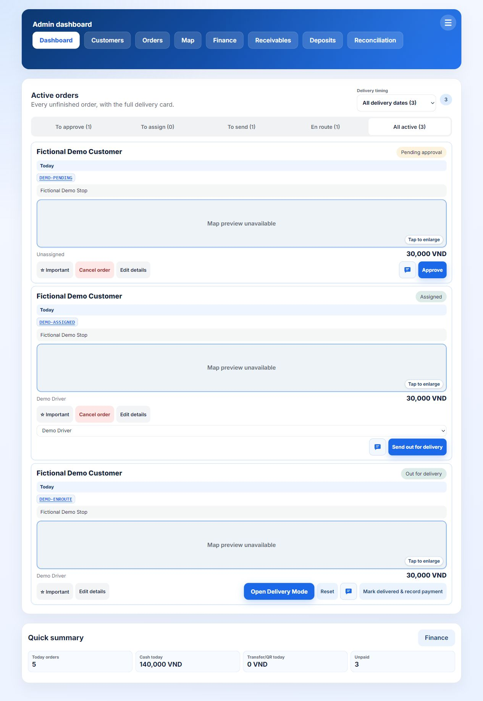

# Delivery Management Template

A reusable water-delivery application maintained by Ty. Vietnam Sparkle is its
personalized implementation; Ty retains ownership of the reusable template.
Current development uses fictional test data. Keep the business deployment and
reusable code separate during handover.

## Features and architecture

Customer order intake and tracking; owner approval and dispatch; driver assignment
and delivery; payment and customer-balance records; returnable-container deposits;
cancellations, refunds, reports, staff access and business settings.

The current application lives in `firebase/`: browser JavaScript/HTML, Firebase
Authentication, Firestore, Storage, and Node.js Cloud Functions. Public order
submission and important money operations use server callables, with security
rules and server-side role checks. `apps-script/` and `site-preview/` are legacy.

## Start here

See [local setup and verification](firebase/README.md) for installation,
fictional-data preview and test commands. No production credentials are required
for the isolated preview or pure tests.

See [template boundaries and next tasks](docs/TEMPLATE.md) for development scope.
This repository remains private; this documentation grants no open-source license.

## Release status

The 2026-11-08 review preparation reconciles the last verified live web release
and the release-recorded staff/help/AI backend features. Older unfinished local
variants are preserved separately. See [reconciliation and verification](docs/RECONCILIATION.md)
for the exact scope, tests and remaining limits. This is not a production handover
certification; HANDOFF.md and SHIP-READINESS.md retain the operational checklist.

## Fictional-data screenshots

[Phone dashboard](docs/screenshots/demo-dashboard-mobile.jpg) ·
[Customer catalogue and order](docs/screenshots/demo-customer-order.jpg)

Read AGENTS.md before editing: agents share a working directory. Never commit
credentials, business exports, emulator snapshots or real customer information.
Source control does not back up Firebase business records.
